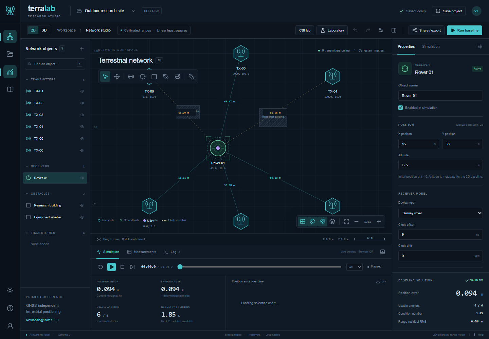
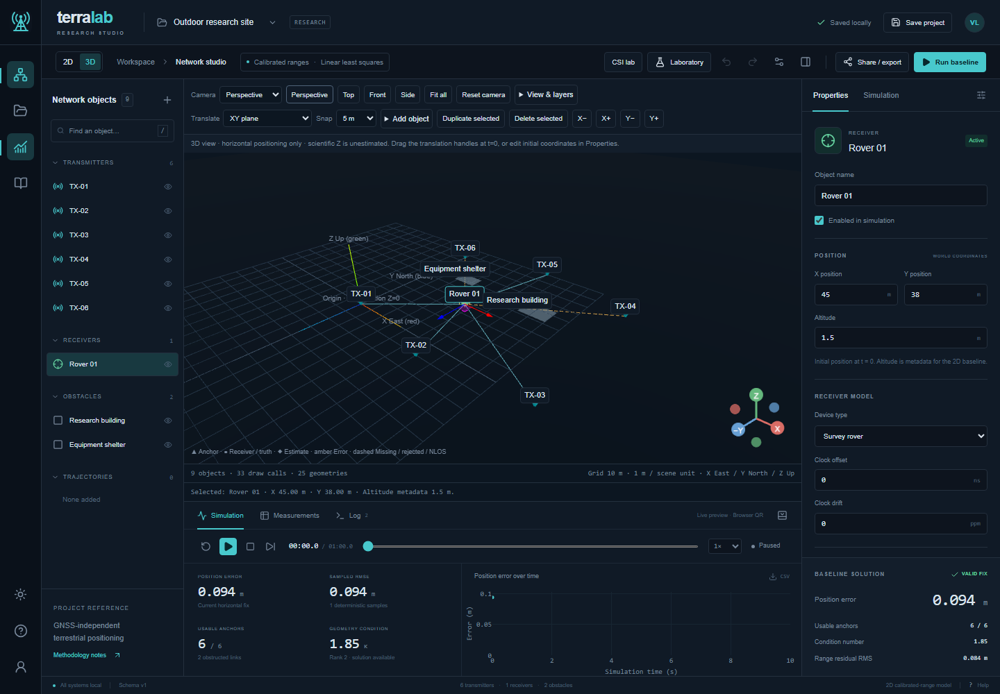
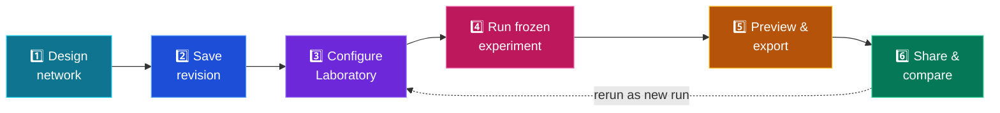

<div align="center">


<a href="https://git.io/typing-svg">
  
</a>

<br/>


### 🛰️ Can a network of ground transmitters locate a moving receiver — accurately and reliably — without GNSS?

**[🚀 Quick Start](#-quick-start)** · **[🧭 Workflow](#-research-workflow)** · **[📡 Techniques](#-positioning-techniques)** · **[🎯 Use Cases](#-use-cases)** · **[🌐 2D / 3D](#-2d-and-3d-workspaces)** · **[📚 Docs](#-documentation)**

</div>

---

## 🖼️ See It

<div align="center">



<sub>Network Studio: transmitters, a rover, obstacle footprints, live position error and the calibrated-range baseline.</sub>



<sub>Optional 3D inspection shares the project and selection. Scientific positioning remains horizontal XY.</sub>

</div>

---

## ✨ What Is TerraLab?

TerraLab is a **web workspace for research and learning** for GNSS-independent positioning with terrestrial radio transmitters. You place anchors with known coordinates, move a receiver through the world, generate measurements from documented models, estimate the position, and study *why* the error is what it is.

> [!IMPORTANT]
> **Scientific integrity first.** No fabricated accuracy numbers. No decorative charts. Every output comes from an implemented measurement model, estimator, or experimental calculation, and every saved result is tied to its exact configuration and random seed.

<table>
<tr>
<td width="25%" align="center">

### 🗺️
**Network Studio**<br/>
Design anchors, receivers, obstacle footprints and trajectories in the default 2D editor or optional 3D view.

</td>
<td width="25%" align="center">

### 🔬
**Laboratory**<br/>
Pick a measurement type and a compatible estimator. Run frozen, reproducible experiments.

</td>
<td width="25%" align="center">

### 📊
**Analytics**<br/>
RMSE, percentiles, CDFs, residuals, geometry condition and runtime from real outputs.

</td>
<td width="25%" align="center">

### 🤝
**Collaboration**<br/>
Versioned cloud projects, teams, expiring invites and immutable experiment history.

</td>
</tr>
</table>

---

## 🚀 Quick Start

Open **[TerraLab](https://terra-lab-wine.vercel.app/)** in your browser. No local installation or worker is required.

1. **Try it:** open Research workspace and click **Run demo**. The receiver moves automatically along a waypoint route. Your previous workspace is preserved.
2. **Design a network:** choose a starter network, open a project, or import project JSON. Select an object to edit its properties.
3. **Choose a view:** the editor starts in **2D**. Select **3D** for orbiting, camera presets and a spatial inspection of the same network.
4. **Save your work:** local projects stay in this browser. Sign in for cloud projects, teams, revisions and shared experiment history.
5. **Run an experiment:** sign in for hosted calculations, open **Laboratory**, choose a measurement model and compatible estimators, set a seed, and run a short experiment. Inspect failures as well as accuracy.

Signed-in visits open **[Research workspace](https://terra-lab-wine.vercel.app/projects)**. Signed-out visits open **[Network Studio](https://terra-lab-wine.vercel.app/studio)**. The free scientific service can take about a minute to wake after inactivity; wait and retry if the first request times out.

## 🌐 2D and 3D Workspaces

The **2D** editor remains the default. It supports the existing SVG tools, project coordinates, simulations and scientific overlays independently of WebGL.

The optional **3D** view shares your project and selection. Orbit, pan and zoom; choose perspective or orthographic projection; use top, front and side views; fit the network; and translate supported objects with snapping or the Properties inspector. Camera settings and display layers do not alter experiment parameters or create scientific revisions.

> **3D visualization is not 3D positioning.** Current solvers estimate horizontal XY only. Missing Z coordinates are displayed on an explicitly defined plane, not treated as surveyed elevations. Receiver altitude is metadata. Buildings and walls can have user-entered Z height and base elevation; unknown dimensions use an explicitly illustrative fallback. These dimensions do not change horizontal propagation or estimation. Recorded estimates and uncertainty stay on the XY plane—no vertical fix, covariance ellipsoid or RF propagation volume is invented.

If WebGL is unavailable or its context is lost, return to 2D with the same project. See the [user guide](docs/USER_GUIDE.md) and [coordinate model](docs/3d/COORDINATE_MODEL.md).

---
## 🧭 Research Workflow



<details>
<summary><b>1️⃣ Design a network</b></summary>

<br/>

Open **Research workspace** from the folder icon. Create a starter network, import JSON, or reload an owned/shared project. Drag and edit **anchors, receiver, obstacles and trajectories**. Choose from **ten themes** in Settings. Mobility, controls, undo/redo and the calibrated-range baseline are all available.

</details>

<details>
<summary><b>2️⃣ Save structured configurations</b></summary>

<br/>

Cloud saves **append revisions** and **reject stale versions**. The dashboard supports personal, recent, shared, starred and archived projects, recent experiments, saved network templates, search, sort, copy, archive, delete and teams.

- Restoring a revision **creates a new revision**.
- Conflicts offer **reload** or **save-copy** recovery.
- Projects with immutable history are **archived**, not hard-deleted.

</details>

<details>
<summary><b>3️⃣ Open the Laboratory</b></summary>

<br/>

Independently choose the **measurement model** and a **compatible estimator**, then configure noise, propagation, mobility, filters, seed, trials and sweeps, all with explicit units and bounds.

</details>

<details>
<summary><b>4️⃣ Run and inspect</b></summary>

<br/>

Every run uses a **new frozen configuration**. Watch progress, cancel if needed, then inspect accuracy, failures, runtime and observation diagnostics. Historical results **never change** when you edit the workspace later. Compare two runs' complete nested configurations, or rerun as a new project/run.

</details>

<details>
<summary><b>5️⃣ Preview and export</b></summary>

<br/>

Preview recorded scientific layers, then export:

`JSON` · `CSV` · `Screenshot PNG` · `Publication SVG/PNG` · `Generated PDF` · `Reproducibility manifest`

Figures use stored output. Sampled displays and failure conditioning are labelled. Small derived files can optionally be appended to private cloud artifact history.

</details>

<details>
<summary><b>6️⃣ Share and collaborate</b></summary>

<br/>

Grant **viewer** or **editor** access directly or through a team.

- Invitations **expire in seven days** and require sign-in.
- Every invitation kind grants the project's complete history/export scope.
- Tokens are stored **hashed**.
- Revocation stops new redemption; remove accepted members separately.
- No automatic email and no real-time multiwriter layer is claimed.

</details>

<details>
<summary><b>7️⃣ Explore the CSI lab</b></summary>

<br/>

A separate module for **synthetic multipath/channel data**, matched/weighted scans, **experimental MUSIC** and **restricted single-band ESPRIT**. Full Kazaz MBWDE, CRB reproduction and hardware validation remain documented gaps.

</details>

---

## 📡 Positioning Techniques

Measurement type and estimator are chosen **independently**. Incompatible pairs are disabled with an explanation.

### 📐 Measurement models

| | Technique | What is measured | Clock handling |
|---|---|---|---|
| ⏱️ | **TOA (calibrated)** | Geometric range from time of flight | Calibrated |
| 🕰️ | **TOA (unknown-clock pseudorange)** | Range plus receiver clock bias | Bias estimated |
| ➗ | **TDOA** | Range differences vs a reference anchor | Common-reference covariance aware |
| 🔁 | **RTT** | Two-way ranging with turnaround correction | Calibrated turnaround |
| 🧭 | **AOA** | 2D bearings | Not applicable |
| 📶 | **RSS** | Log-distance path-loss power | Not a direct distance measure |
| 🧬 | **Hybrid** | Declared combinations | Only with a defined objective and covariance |

### 🧮 Estimators

| Family | Methods |
|---|---|
| **Linear / weighted** | LS · WLS |
| **Nonlinear** | NLS · MLE |
| **Robust** | Huber / soft-L1 robust fits · residual rejection · RANSAC |
| **Recursive** | EKF · UKF (constant-velocity models) |

> [!NOTE]
> Comparisons use the **same generated observations** for every estimator, so differences reflect the estimator, not the random draw.

<details>
<summary>🧪 <b>Pseudorange vs calibrated range: why it matters</b></summary>

<br/>

A calibrated range is just geometry:

```
d_i = ‖p − a_i‖
```

A one-way pseudorange also contains the receiver clock offset `b` and hardware bias `h_i`:

```
ρ_i = ‖p − a_i‖ + c·b + h_i + ε_i
```

TerraLab never silently solves an unknown-clock problem with a calibrated-range equation.

</details>

<details>
<summary>📘 <b>Implementation status</b></summary>

<br/>

See the [research methodology matrix](docs/research/methodology-matrix.md) for each technique's math, required measurements, anchor geometry, synchronization assumptions, limitations, validation strategy and status, clearly separating *validated*, *implemented but not fully validated*, *simplified approximation* and *planned* items.

</details>

---

## 🎯 Use Cases

<table>
<tr>
<th width="22%">🎓 Who</th>
<th width="38%">🧪 What they do</th>
<th width="40%">📈 What they learn</th>
</tr>
<tr>
<td><b>Student</b></td>
<td>Place four anchors, add a rover, run the baseline, then raise measurement noise.</td>
<td>How geometry and noise change position error and condition number.</td>
</tr>
<tr>
<td><b>Researcher</b></td>
<td>Sweep timing uncertainty with a fixed seed across LS, WLS and robust methods.</td>
<td>Whether weighted or robust multilateration beats plain LS, and when it does not.</td>
</tr>
<tr>
<td><b>Urban planner / RF engineer</b></td>
<td>Add building obstacles, mark links as obstructed, and inspect NLOS effects.</td>
<td>Which anchors degrade the fix and where coverage is weak.</td>
</tr>
<tr>
<td><b>Tracking developer</b></td>
<td>Drive a receiver along a survey route and compare NLS against EKF/UKF.</td>
<td>How motion models and filters behave under mobility.</td>
</tr>
<tr>
<td><b>Signal-processing researcher</b></td>
<td>Open the CSI lab and generate synthetic multipath channels.</td>
<td>How bandwidth and band separation affect delay resolution.</td>
</tr>
<tr>
<td><b>Faculty / peer reviewer</b></td>
<td>Open a shared project, inspect its immutable run, compare it with another run.</td>
<td>Whether results are reproducible from the stored configuration and seed.</td>
</tr>
</table>

<details>
<summary>🔎 <b>Example scenario: &ldquo;Does robust beat ordinary LS under NLOS?&rdquo;</b></summary>

<br/>

1. Build a network with 6 anchors and a few building obstacles.
2. In **Laboratory**, enable NLOS probability with a positive range bias.
3. Select **LS**, then a **robust** estimator, using the **same seed**.
4. Run both estimators in the same experiment.
5. Compare estimator curves, RMSE, 95th percentile and failures. Use historical comparisons to inspect configuration differences.
6. Export the PDF report. It includes the seed, configuration and software version.

</details>

---

## 🧱 What You Can Control

<details>
<summary>🌐 <b>Network objects</b></summary>

<br/>

- **Transmitters / anchors**: position, enable state, power, carrier, bandwidth, clock offset/drift, timing uncertainty, hardware delay.
- **Receivers**: position, mobility mode, speed, heading, sampling interval and clock offset/drift.
- **Obstacles**: buildings, walls, polygons, blocking regions.
- **Trajectories**: waypoints, polylines, reversal, looping, speed.

</details>

<details>
<summary>🎛️ <b>Experiment parameters</b></summary>

<br/>

Noise, propagation, mobility, filter settings, random seed, number of trials and parameter sweeps, each with **explicit units and bounds**. See the [parameter reference](docs/LAB_PARAMETER_REFERENCE.md).

</details>

<details>
<summary>🗺️ <b>Canvas interactions</b></summary>

<br/>

Select, multi-select, drag, pan, zoom, fit, snap to grid, grid toggle, measure distance, undo/redo, layer visibility. Everything uses **real metres**: zoom never changes physical distances.

</details>

---

## 📊 Reading Your Results

RMSE, percentiles and error curves describe successful simulated fixes. Availability and failure counts show how often a fix could be produced. Compare both before deciding which estimator performs better.

Saved outputs retain their configuration, random seed, estimator, epoch and observation data. Editing the network does not change a historical experiment. Use the same observation frame for fair estimator comparisons, and rerun a changed configuration as a new experiment.

For detailed interpretation, see the [scientific methods](docs/PHASE_2_METHODS.md), [parameter reference](docs/LAB_PARAMETER_REFERENCE.md), and [validation/reproduction notes](docs/REPRODUCTION.md). Local automated tests and hosted acceptance are documented separately; neither is a claim of hardware accuracy.

---
## 🧭 Known Limitations (Read These)

- Synthetic horizontal positioning is **not** validated RF hardware performance.
- WLS and MLE assume **nominal Gaussian covariance**.
- Robust methods **need not** improve every case.
- EKF and UKF use **constant-velocity** models.
- Scientific model **0.2.0** remains authoritative for existing results.
- CSI MUSIC is **experimental**; single-band ESPRIT is restricted; full Kazaz MBWDE and CRB reproduction are open gaps.
- Cloud, browser and provider acceptance is **not inferred** from a local production build.
- The optional **3D view is planar scientific visualization**. It does not add a vertical positioning solver or surveyed Z fields to existing projects.

---

## 📚 Documentation

<table>
<tr>
<td width="33%" valign="top">

**🧑‍💻 Using it**
- [User guide](docs/USER_GUIDE.md)
- [Troubleshooting](docs/TROUBLESHOOTING.md)

</td>
<td width="33%" valign="top">

**🔬 Science**
- [Scientific methods](docs/PHASE_2_METHODS.md)
- [Parameter reference](docs/LAB_PARAMETER_REFERENCE.md)
- [Advanced CSI scope / gaps](docs/ADVANCED_SIGNALS.md)
- [Methodology matrix](docs/research/methodology-matrix.md)

</td>
<td width="33%" valign="top">

**🌐 Spatial inspection**
- [2D / 3D user guide](docs/USER_GUIDE.md)
- [Coordinate model and Z limits](docs/3d/COORDINATE_MODEL.md)
- [3D architecture and scope](docs/3d/ARCHITECTURE.md)
- [3D validation notes](docs/3d/TEST_PLAN.md)

</td>
</tr>
</table>

---

<div align="center">

**TerraLab is a research tool, not a dashboard mock-up.**<br/>
<sub>If a number is on screen, it came from a model you can read and a seed you can rerun.</sub>


</div>

### Research workflow improvements

The dashboard follows your selected palette. Rename projects directly in Studio, inspect parameter explanations in Laboratory, and choose baseline durations up to 60 minutes or laboratory trajectories up to five minutes within the existing work budget.

Buildings, walls and obstacles support explicit width (X), footprint depth (Y), height (Z) and optional base elevation in the 3D view. Saved view presets stay separate from scientific settings.

Select two to four saved experiments to compare full-data metrics, configuration differences, error CDFs, standardized residuals and selected trajectories. Export complete sources, CSV, SVG/PNG charts, a manifest and a printable report. Named report collections are browser-local references. Conflicting saves preserve your draft and offer comparison, copy and deliberate reapply workflows.

## AI Studio foundation

Phase 3 adds repeatable research workflows, reviewed fixed-command local tests and task recovery. On the configured Windows laptop, run `node scripts/start-local-ai.mjs` and open `http://127.0.0.1:13040/ai`. It uses installed free local Qwen3 Instruct for research tools and DeepSeek-R1 8B for explanations, with cloud inference disabled and no API key. Startup downloads nothing. Use `--status` / `--stop` to manage its recorded processes. See [setup](docs/ai/PROVIDER_SETUP.md), [test plan](docs/ai/TEST_PLAN.md), and [Phase 3 report](docs/ai/PHASE_3_REPORT.md). Local tests require trusted source; hosted test execution is disabled.

Phase 2 extends `/ai` with a bounded research agent, reviewed network/parameter changes, real queued experiments, recorded metrics, comparison, cancellation and recovery. See [workflows](docs/ai/AGENT_WORKFLOWS.md), [tools and permissions](docs/ai/TOOLS_AND_PERMISSIONS.md), [actual parameter reference](docs/ai/PARAMETER_REFERENCE.md), and [OpenCode Free / Harness setup](docs/ai/FREE_MODEL_AND_HARNESS_SETUP.md). Explanation-only mode retains the original Phase 1 behavior; live inference requires your supported provider configuration.

Open `/ai` from the project library or Network studio. Phase 1 provides read-only
project explanations through your own DeepSeek API account, with optional local
Ollama in explicit development mode. No autonomous edits or experiment execution.
Provider credentials use an encrypted, user-bound HttpOnly cookie, never project
metadata. No AI service is configured by default.

See [provider setup](docs/ai/PROVIDER_SETUP.md),
[architecture research](docs/ai/RESEARCH_AND_ARCHITECTURE.md),
[security and limits](docs/ai/SECURITY_AND_LIMITS.md), and
[Phase 1 verification](docs/ai/PHASE_1_REPORT.md).
