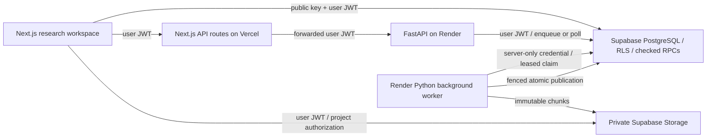

# TerraLab architecture

Platform API 0.3.0; validated positioning model 0.2.0; project schema 1. Phase 3 extends the existing application and leaves the numerical `execute`, `generate`, `estimate` and tracking implementations unchanged.

The browser holds structured project configurations, editor undo/redo, an origin-local recovery copy and IndexedDB experiment snapshots. Supabase Auth maintains the user session. Direct database reads obey RLS; writes to projects, revisions, team membership, invitations and jobs use explicitly checked, narrowly granted RPCs. The owner cannot be changed through a save. Private helper functions avoid recursive membership policies. Every definer function pins an empty search path and qualifies relations.

Project writes take an advisory lock and row lock, compare `cloudVersion`, insert an immutable revision and return the new version in one transaction. An in-flight save can advance metadata without discarding edits made while it ran. Undo/redo keeps the current cloud version. A conflict preserves the working copy and exposes reload/save-copy recovery in the dashboard. Team assignment advances the revision, but restoring network state does not roll back security membership.

In production, FastAPI validates bounded numerical requests and uses the caller's JWT with PostgREST. It does not receive the service credential. PostgreSQL serializes submissions per user, enforces four active jobs/user and 100 globally, and makes request keys idempotent. The worker claims rows with `FOR UPDATE SKIP LOCKED`, heartbeat leases and fresh lease tokens. Only worker RPCs may claim or finalize. Expired attempts restart from the saved immutable request, at most twice; old leases cannot publish. Retry exhaustion and 24-hour abandoned queues become explicit terminal failures. This is at-least-once computation with fenced, single-publication output, not exactly-once computation.

The worker writes UTF-8 JSON in base64 chunk envelopes to a private bucket, under job/lease paths. It then atomically inserts the immutable run manifest and final job status. The manifest checks full byte length and SHA-256; the browser retrieves chunks directly with its JWT so multi-megabyte results do not cross Vercel's response body limit. A failed upload has no complete manifest. Orphaned failed-attempt objects can remain for administrator cleanup; authenticated users cannot modify or delete worker output. Metadata/errors/logs survive independently of a failed artifact publication.

Derived SVG/PNG/PDF/JSON/CSV/manifest exports can optionally be appended to `research_artifacts` with their own hashes and provenance. These are explicitly user-generated derivatives; they do not modify the run, and a user-supplied artifact is not a signed scientific attestation. Both buckets remain private. Historical Phase 2 `project-exports` snapshots remain available as personal backups, separate from worker-published research history.

Small local development runs use the existing single numerical thread and atomic ignored files. Production startup rejects local mode. The bounded CSI demonstration and PDF generation run in FastAPI's sync thread pool behind a two-operation per-instance semaphore; they are not a large CSI batch scheduler. Full Monte Carlo work uses the separate worker. Limitations and deployment settings are in [DEPLOYMENT.md](DEPLOYMENT.md).

No real-time multiwriter layer was added. Collaboration uses explicit saves, revisions, optimistic conflicts and immutable results. Permission revocation prevents future server reads; already downloaded files/local browser copies cannot be recalled.
